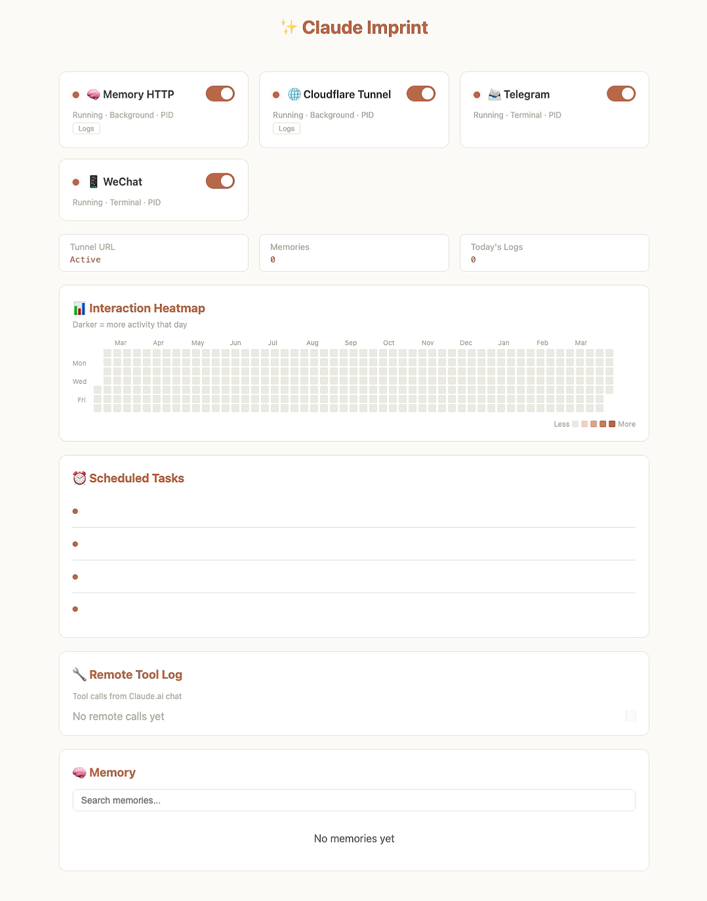

# Claude Imprint

A self-hosted system that gives Claude persistent memory, multi-channel messaging, and automation. Talk to it from Claude Code, Claude.ai, or Telegram — it remembers everything and shares context across channels. Other channels (Discord, Slack, etc.) can be added via their own MCP servers.

Built for **Claude Code Pro/Max subscribers**. Uses only official Claude Code features — no API costs, no third-party auth.

> ⚠️ **Security notice (Oct 2026).** This repo was built in May 2026. If you set up the Claude.ai integration (`imprint-memory --http`) back then, upgrade: `pip install -U imprint-memory` (0.4.1+).
> - Older imprint-memory let any request coming from `127.0.0.1` skip the token. Cloudflare Tunnel passes the real client IP, so the setup below stayed locked, but plain TCP forwarders (frp, ssh -R, socat, port-forward services) make every outside request look local. 0.4.1 always requires the token and won't start HTTP mode without one.
> - imprint-memory 0.1.0 / git installs from before 2026-05-17 let anyone in when no credentials were set and included a `cc_execute` tool that could drive your local Claude Code. If you exposed one of those, upgrade and assume the memory was readable.
> - `cron-task.sh` runs Claude Code with `--dangerously-skip-permissions`. Anything those prompts read (web pages, email, messages) can steer it, so keep cron prompts on trusted input.
>
> 中文：五月装过并开了 Claude.ai 远程（`--http`）的，请 `pip install -U imprint-memory` 升到 0.4.1。旧版对本机来的请求不验 token，用 frp / ssh -R / 花生壳这类纯转发穿透时等于没锁；最早的 0.1.0 没配凭据时谁都能进。定时任务脚本用了 `--dangerously-skip-permissions`，只喂可信的输入。

> **Just want persistent memory?** The memory system is a standalone package: [imprint-memory](https://github.com/Qizhan7/imprint-memory). Install it alone with `pip install` — no need for the full Imprint stack. This repo adds multi-channel messaging, automation, dashboard, and everything else on top.

## Features

### 🧠 Memory
- **Hybrid search** — FTS5 full-text + bge-m3 vector embeddings + exact-match keyword, fused with RRF ranking and time-decay scoring. Replaces Claude Code's built-in file-based memory.
- **CJK support** — Chinese/Japanese/Korean text segmented with jieba for accurate full-text search.
- **Unified across interfaces** — The same SQLite backend serves Claude Code (stdio MCP) and Claude.ai (HTTP MCP via Cloudflare Tunnel). Memories saved in one are instantly searchable from the other.
- **Categorized storage** — Memories tagged by type (facts, events, tasks, experience) and source. Search by category or let hybrid search find the best match.
- **Knowledge bank** — Long-form structured knowledge in Markdown files (`memory/bank/`). Preferences, relationships, technical experience — all indexed and included in semantic search.
- **Daily logs** — Automatic daily journals. Pre-compaction hooks capture context before it's compressed. Nothing gets lost.

### 💬 Multi-Channel
- **Telegram** (primary) — Full-featured: chat, file sharing, heartbeat notifications, morning briefings, direct messaging from Claude.ai. Uses Anthropic's official Claude Code Telegram plugin.
- **Claude.ai** — Connect via Cloudflare Tunnel + OAuth. Full memory access from the web and mobile apps.
- **Cross-channel context** — Messages flow in from all sources. Claude keeps a shared timeline of what happened where. When you switch devices, it already knows the context.
- **Pluggable channels** — The system auto-detects any Claude Code channel plugin (Discord, Slack, etc.). Just install the MCP server and messages are automatically logged, tagged, and searchable.

### 🎮 Remote Control (requires [Chat Integration](#chat-integration-claudeai--local-memory) + additional MCP packages)
- **Direct Telegram messaging** — Claude.ai sends to your Telegram via Bot API. Requires `imprint_telegram` MCP (see [Telegram setup](#telegram)).
- **System monitor** — Check CPU, RAM, disk, running services. Requires `imprint_utils` MCP.
- **Webpage reader** — Fetch and read any URL. Requires `imprint_utils` MCP.
- **Spotify control** — Play, pause, skip, volume. Requires `imprint_utils` MCP. macOS only (AppleScript).

### ⚡ Automation
- **Scheduled tasks** — Morning briefing, reminders, nightly memory consolidation. Customizable cron prompt templates.
- **Heartbeat agent** — Periodic automated checks with proactive Telegram notifications.
- **Hooks** — Pre-compaction context saver + post-response conversation logger with auto-compression.

### 📊 Dashboard
- **Control panel** — Single-file FastAPI app (localhost:3000). Start/stop services, browse memories, view scheduled tasks, conversation stream stats, and a GitHub-style interaction heatmap.



## Platform support

| Feature | macOS | Linux / Cloud |
|---------|-------|---------------|
| Memory system, dashboard, hooks, cron | ✅ | ✅ |
| Telegram, Claude.ai integration | ✅ | ✅ |
| `start.sh` / `stop.sh` | ✅ Terminal windows | ✅ Background processes |
| Spotify control | ✅ | ❌ AppleScript only |

### Cloud server deployment

Core features (memory, HTTP server, dashboard, Telegram, heartbeat, cron) work on Linux cloud servers. Claude Code runs as a CLI tool — a basic VPS (1 CPU, 1GB RAM) is sufficient; the AI inference happens on Anthropic's servers, not yours.

```bash
# Quick start on a cloud server
git clone https://github.com/Qizhan7/claude-imprint.git && cd claude-imprint
python3 -m venv .venv && source .venv/bin/activate
pip install -r requirements.txt

# Authenticate Claude Code (Max Plan OAuth token)
mkdir -p ~/.claude && echo "your-token" > ~/.claude/cron-token

./start.sh   # starts all services as background processes
./stop.sh    # stops everything
```

For production deployments, systemd service templates are provided in [`deploy/`](deploy/). See [`deploy/README.md`](deploy/README.md) for full instructions.

## Prerequisites

- **Python 3.10+** (required by imprint-memory for type hint syntax)
- **Claude Code** (Pro or Max subscription)
- **macOS or Linux**

## Quick start

```bash
git clone https://github.com/Qizhan7/claude-imprint.git
cd claude-imprint

python3 -m venv .venv && source .venv/bin/activate
pip install -r requirements.txt

# Register memory MCP server
claude mcp add -s user imprint-memory -- imprint-memory

# Start dashboard
python3 packages/imprint_dashboard/dashboard.py
# → http://localhost:3000
```

You now have persistent memory in Claude Code. Add modules below for more.

## Modules

### Chat integration (Claude.ai → local memory)

Connect Claude.ai to your local memory via Cloudflare Tunnel + HTTP MCP.

```bash
# 1. Generate OAuth credentials (HTTP mode refuses to start without them)
python3 scripts/generate_oauth.py   # → ~/.imprint-oauth.json

# 2. Start HTTP server
imprint-memory --http   # → 127.0.0.1:8000, bearer token always required

# 3. Expose via tunnel
cloudflared tunnel --url http://localhost:8000

# 4. Claude.ai → Settings → Connectors → Add Custom Connector
#    Enter tunnel URL + client_id / client_secret from ~/.imprint-oauth.json
```

Use Cloudflare Tunnel (or anything that forwards the client IP). Needs imprint-memory 0.4.1+; on older versions a plain TCP forwarder bypasses the token.

### Telegram

```bash
claude /telegram:configure
claude --permission-mode auto --channels plugin:telegram@claude-plugins-official
```

### Automation

```bash
# Heartbeat agent (periodic checks + Telegram notifications)
python3 packages/imprint_heartbeat/agent.py

# Cron tasks — use prompt templates in cron-prompts/
bash cron-task.sh morning-briefing cron-prompts/morning-briefing.md
```

Cron templates: `morning-briefing.md`, `drink-water.md`, `health-check.md`, `nightly-consolidation.md`, `weekly-memory-audit.md`. Edit to fit your style and schedule with crontab.

> **Note:** Templates that use `send_telegram` or `system_status` need the full MCP config. The runner auto-detects `cron-mcp-full.json` (includes telegram + utils) if present, otherwise falls back to `cron-mcp.json` (memory only).

### Hooks

```bash
# Save context before compaction
claude settings add-hook PreCompact "bash $(pwd)/hooks/pre-compact-flush.sh"

# Log conversations after each response
claude settings add-hook Stop "bash $(pwd)/hooks/post-response.sh"
```

### Adding other channels (Discord, Slack, etc.)

The system auto-detects any Claude Code channel plugin. No code changes needed — just install the channel MCP and everything works:

1. **Install the channel's MCP server** (e.g. a Discord MCP from the community)
2. **Register it in `.mcp.json`** alongside imprint-memory
3. **Start Claude Code** with both the channel and imprint-memory loaded

What happens automatically:
- **Memory** — `memory_remember`, `memory_search`, etc. work immediately
- **Conversation logging** — The post-response hook detects the new channel by name and tags all messages with the correct platform (e.g. `discord`)
- **Cross-channel context** — Messages appear in `recent_context.md` and the CLAUDE.md AUTO section, visible to all other channels
- **Search** — Use `conversation_search(query)` for all platforms, or `search_channel(query, "discord")` for a specific one
- **Dashboard** — Stream stats show the new platform automatically; unknown platforms get a neutral color tag
- **RRF hybrid search** — Works across all platforms, no configuration needed

### Semantic search (optional)

```bash
ollama pull bge-m3 && ollama serve
```

Without this, keyword search still works — you just don't get vector similarity.

## Configuration

| Variable | Default | Description |
|----------|---------|-------------|
| `IMPRINT_DATA_DIR` | `~/.imprint` | Directory for memory.db and files |
| `TZ_OFFSET` | `0` | UTC offset (e.g. `12`, `-5`) |
| `HEARTBEAT_INTERVAL` | `900` | Heartbeat interval (seconds) |
| `TELEGRAM_BOT_TOKEN` | — | From @BotFather |
| `TELEGRAM_CHAT_ID` | — | From @userinfobot |
| `QUIET_START` / `QUIET_END` | `23` / `7` | No proactive messages during these hours |

See [imprint-memory](https://github.com/Qizhan7/imprint-memory) for memory-specific config (embedding provider, model, etc).

## Customizing your Claude

The system is shaped by a few Markdown files. See **[docs/customization.md](docs/customization.md)** for the full guide.

The short version:

| File | What it does | Who writes it |
|------|-------------|---------------|
| `~/.claude/CLAUDE.md` | Personality, preferences, rules — the brain | You |
| `HEARTBEAT.md` | Heartbeat behavior + checklist | You |
| `memory/bank/*.md` | Structured knowledge (preferences, experience, relationships) | You + Claude |
| `MEMORY.md` | Auto-generated memory index | System |
| `memory/YYYY-MM-DD.md` | Daily logs | System |

## Acknowledgements

[imprint-memory](https://github.com/Qizhan7/imprint-memory) · [Anthropic](https://anthropic.com) · [Ollama](https://ollama.com) + [bge-m3](https://huggingface.co/BAAI/bge-m3)

## License

[AGPL-3.0](LICENSE) — free for personal use; commercial use requires open-sourcing your entire project under AGPL.
